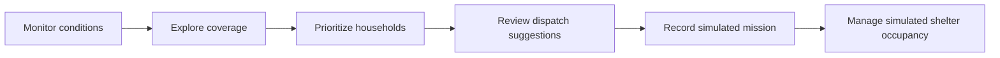

<div align="center">

# 🛡️ NIGEHBAAN

### Pakistan Disaster Response System

**Detect earlier. Verify faster. Respond smarter.**

*A geographic intelligence and emergency-response planning prototype built to make disaster scenarios easier to understand, prioritize, and coordinate.*

[](https://nextjs.org/)
[](https://react.dev/)
[](https://www.typescriptlang.org/)
[](https://leafletjs.com/)
[](#important-disclaimer)

[Explore Features](#-what-nigehbaan-does) · [See the Workflow](#-how-it-works) · [Run Locally](#-getting-started) · [Data Transparency](#-data-sources--transparency)

</div>

---

## 🌍 The idea

During floods and other emergencies, information can be scattered across weather reports, maps, affected households, available resources, and shelter records. **Nigehbaan** brings these perspectives together in one accessible interface so a response-planning team can explore scenarios, identify priorities, and record simulated actions.

The project focuses on a simple question:

> **How can we turn fragmented disaster information into a clearer, more actionable response workflow?**

Nigehbaan is a **hackathon demonstration and decision-support simulation**, not an operational emergency service.

## ✨ What Nigehbaan does

| Module | What you can do |
| --- | --- |
| **Overview / Live Intelligence** | Review district context, key indicators, and model-based weather information in a unified dashboard. |
| **Coverage Map** | Explore a Karachi-wide map, select districts, and inspect available geographic layers and their limitations. |
| **Command Center** | Adjust flood scenarios, review household priorities, and explore suggested dispatch decisions. |
| **Households** | Inspect simulated households and their relative response priority. |
| **Rescue Missions** | Create and update **browser-local simulated missions** through supported status transitions. |
| **Shelters** | Explore candidate facilities and manage **simulated** occupancy and capacity records. |

### Designed for clarity

- **Seven-district navigation** across Karachi: Central, East, South, West, Keamari, Korangi, and Malir.
- **Responsive, light-first interface** with desktop and mobile navigation.
- **Interactive Leaflet mapping** with layer controls, zoom/pan, and readable tile-error fallbacks.
- **Source-aware presentation** that distinguishes geographic references from synthetic scenarios.
- **Keyboard-friendly controls** and non-map navigation alternatives.
- **Local demo persistence** for supported mission and shelter workflows.

## 🔁 How it works



**Important:** A dispatch suggestion does **not** automatically deploy a real rescue team. Completing a mission does **not** automatically register a shelter arrival. These are separate planning and recording steps in the prototype.

## 🗺️ Geographic coverage

Nigehbaan includes a **Karachi city overview** and navigation for all seven configured districts.

- **Malir** has a limited set of sourced, OSM-derived geographic sample points and candidate facilities, alongside clearly marked simulated response data.
- **Central, East, South, West, Keamari, and Korangi** provide district-specific **synthetic, non-map scenarios**; their demo households and shelters are not presented as real mapped locations.
- **Verified district boundary polygons are not currently included.** The application does not draw guessed borders or claim complete geographic coverage.

The map requires external tile availability for its normal basemap. A fallback is provided when tiles cannot load.

## 🧰 Technology stack

| Layer | Technology |
| --- | --- |
| Application | Next.js 16, React 19 |
| Language | TypeScript |
| Styling | Tailwind CSS |
| Maps | Leaflet |
| Weather context | Open-Meteo model-based weather data |
| Data and demo state | Project datasets and browser-local state |
| Quality checks | Automated tests, ESLint, TypeScript, production build, browser smoke testing |

## 🚀 Getting started

### Prerequisites

- A supported Node.js version compatible with the project's Next.js version
- npm
- Internet access for external map tiles and weather requests

### Install and run

```bash
git clone https://github.com/mahnoor2023/Nigehbaan-Pakistan-Disaster-Response-System.git
cd Nigehbaan-Pakistan-Disaster-Response-System
npm ci
npm run dev
```

Open **http://localhost:3000** (or the local address shown in your terminal).

### Verify the project

```bash
npm test
npm run lint
npm run typecheck
npm run build
```

To run a production build locally:

```bash
npm run build
npm run start
```

> Avoid running development and production builds concurrently against the same `.next` directory.

## ☁️ Deployment

Nigehbaan is designed for deployment on **Vercel** as a Next.js project.

1. Import this GitHub repository into Vercel.
2. Select the **`main`** branch.
3. Keep the **Next.js** framework preset and the repository root (`./`).
4. Use the project's default build settings unless your environment requires otherwise.
5. Deploy, then manually verify the dashboard, district switching, map layers, missions, shelters, and mobile layout.

**Environment variables:** The final local release report indicated that no environment variables are required for the current demo configuration. Recheck this if integrations change.

**Deployment status:** This README does not imply that a public production deployment has been verified.

## 🔎 Data sources & transparency

| Data / behavior | What it means |
| --- | --- |
| **Weather** | Open-Meteo model-based current/forecast information; not a verified local ground-station observation. |
| **City map** | OpenStreetMap basemap tiles and attribution, subject to network availability and provider terms. |
| **Malir geographic samples** | Limited OSM-derived point data; geographic references do not establish operational readiness. |
| **Candidate facilities** | Potential locations for demonstration, **not confirmed active shelters**. |
| **Households, dispatch, capacity, routing** | Synthetic scenarios, recommendations, or estimates for demonstration. |
| **Mission records** | Browser-local simulation records; no shared emergency-dispatch backend. |
| **District boundaries** | Not displayed as verified polygons because a complete, validated, reusable set has not been established. |

For geographic-source decisions and limitations, see [`docs/BOUNDARY_SOURCE_VERIFICATION.md`](docs/BOUNDARY_SOURCE_VERIFICATION.md).

## 🎤 Hackathon demo

A recommended walkthrough:

**Overview → Coverage Map → Command Center → Households → Rescue Missions → Shelters**

Choose **Malir** to demonstrate the available geographic samples. Then adjust a flood scenario, inspect priority and dispatch suggestions, record a simulated mission, and demonstrate browser-local persistence.

See [`docs/DEMO_SCRIPT.md`](docs/DEMO_SCRIPT.md) for the guided presentation and [`docs/RELEASE_CHECKLIST.md`](docs/RELEASE_CHECKLIST.md) for release checks.

## 🧭 Future direction

Potential next steps include validated administrative boundary datasets, authenticated shared records, verified shelter partnerships, stronger data integrations, and operational governance. These are **future possibilities**, not features claimed to be live today.

## ⚠️ Important disclaimer

**Nigehbaan is a hackathon prototype for disaster-response visualization and simulation.** It is **not** an emergency reporting channel, a real-time SOS system, a verified shelter directory, or a live rescue dispatch service. Do not use it to make real-world emergency decisions. For an actual emergency, contact the relevant local emergency services and authorities.

---

<div align="center">

**NIGE HBAAN** · *Detect earlier. Verify faster. Respond smarter.*

Built to explore a more understandable, coordinated approach to disaster-response planning in Pakistan.

</div>
